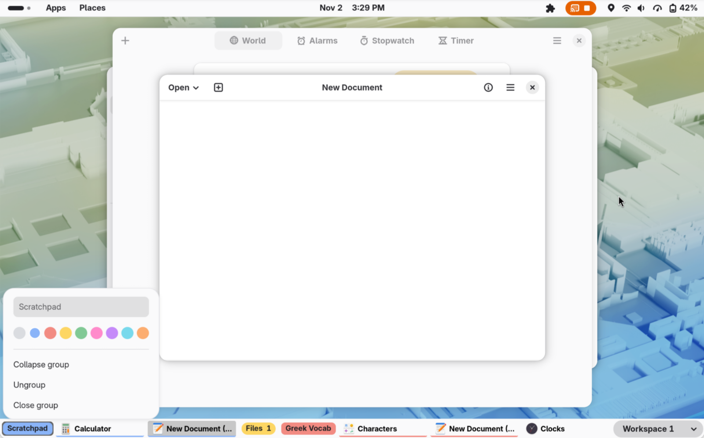
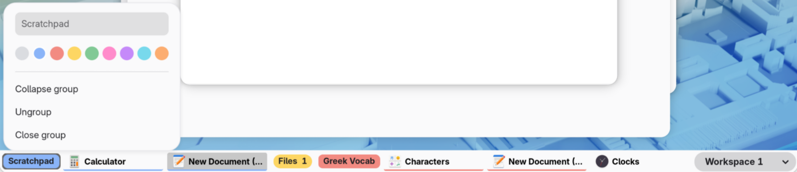

# Window List Tab Groups

Adds Chrome-style tab groups to GNOME Shell's
[Window List](https://gitlab.gnome.org/GNOME/gnome-shell-extensions/-/tree/main/extensions/window-list)
bottom bar. It's an add-on: keep Window List enabled and turn this on next to it.





- **Group windows:** right-click a window → **Add to new group**, then name the group and pick a color.
- **Add or move:** right-click another window → **Add to “…”**, or drag it onto the group's label or windows
  (works on collapsed groups too).
- **Reorder:** drag a group's label to move the whole group.
- **Collapse:** click a group's colored label to hide its windows; click again to show them.
  Switching to a window in a collapsed group (e.g. with Alt+Tab) opens the group.
- **Manage:** right-click the label to rename, recolor, collapse, ungroup or close the group.
- **Leave a group:** right-click → **Remove from group**, or drag the window away from it.

Grouped windows get an underline in their group's color. Groups survive screen lock and
extension reloads, and reset when you log out. Turning the add-on off puts the Window List
back exactly as it was.

Supports GNOME Shell 50.

## Install

From [extensions.gnome.org](https://extensions.gnome.org), or from source:

```bash
git clone https://github.com/medio4/window-list-tab-groups
ln -s "$PWD/window-list-tab-groups" ~/.local/share/gnome-shell/extensions/window-list-tab-groups@jacobcorbley
```

Log out and back in, then:

```bash
gnome-extensions enable window-list@gnome-shell-extensions.gcampax.github.com
gnome-extensions enable window-list-tab-groups@jacobcorbley
```

## How it works

Window List doesn't export its classes, so this extension finds its live window lists
through the extension manager and patches their methods with an `InjectionManager`.
All patches are removed on disable.

## Development

- `./dev.sh` runs a nested GNOME Shell window with both extensions (needs `mutter-devkit`).
- `./pack.sh` builds the zip for extensions.gnome.org.
- Logs: `journalctl -f -o cat /usr/bin/gnome-shell`

## License

GPL-2.0-or-later. See [LICENSE](LICENSE).
